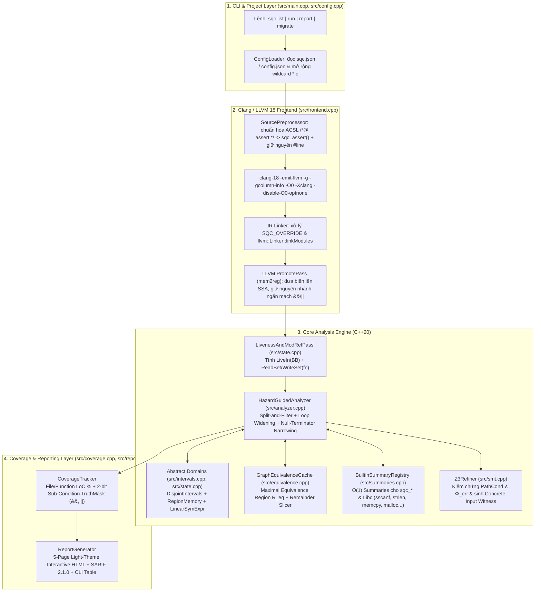

# Tài liệu Kiến trúc Hệ thống & Thuật toán (`sqc` Architecture Document)

Tài liệu này mô tả kiến trúc phần mềm thực tế của công cụ **`sqc`** (100% **Modern C++20 + LLVM 18 + Z3 SMT Solver**, biên dịch bằng **CMake + Ninja** thành binary native duy nhất).

---

## 1. Kiến trúc Tổng thể (System Architecture)

---

## 2. Thiết kế Chi tiết các Module Chính

| Module | File Header & Source | Trách nhiệm Kỹ thuật |
|---|---|---|
| **Config & CLI** | `include/sqc/config.h`, `src/config.cpp`, `src/main.cpp` | Parse JSON bằng `llvm::json`, mở rộng wildcard `*.c`, điều phối `list`, `run`, `report`, `migrate`, lưu/nạp kết quả trong `.sqc_cache/results/`. |
| **Frontend Pipeline** | `include/sqc/frontend.h`, `src/frontend.cpp` | Chuyển đổi `sqc migrate`, giữ nguyên số dòng DWARF bằng `#line 1 "<orig>"`, biên dịch `.c` $\rightarrow$ `.bc` ở `-O0 -g -gcolumn-info`, xử lý `SQC_OVERRIDE` qua `llvm.global.annotations`, chạy `llvm::PromotePass` (`mem2reg`) để giữ nguyên cấu trúc nhánh `&&`/`||`. |
| **DisjointIntervals** | `include/sqc/intervals.h`, `src/intervals.cpp` | Biểu diễn hợp của tối đa $K=8$ khoảng đóng rời nhau $\bigcup [l_i, u_i]$. Hỗ trợ chính xác `unite`, `intersect`, `subtract` (cắt bỏ điểm lỗi như `0` hoặc cắt phần dư `RemainderSlicer`), số học bão hòa `__int128`, và `filter_by_cmp` / `eval_cmp`. |
| **Symbolic State & ModRef** | `include/sqc/state.h`, `src/state.cpp` | `AbstractValue` (`Nullability`, `PointerTarget`, `func_targets`, `DisjointIntervals`, `LinearSymExpr`), `MemoryRegion` (`byte_size`, `liveness`, `null_term_offset`, `field_values`), và `LivenessAndModRefPass` (backward liveness trên SSA/PHI + bottom-up global `ReadSet`/`WriteSet`). |
| **Graph Equivalence Cache** | `include/sqc/equivalence.h`, `src/equivalence.cpp` | Lưu `BehavioralEquivalenceRegion` ($\mathcal{R}_{eq}$) kèm `covered_file_lines` và `subcondition_truth_masks`. Khi có nhánh mới đi vào: kiểm tra **Full Cache Hit** hoặc thực hiện **Remainder Slicing** ($S_{\text{rem}} = S_{\text{in}} \setminus \bigcup \mathcal{R}_{eq}$). |
| **Libc & SQC Summaries** | `include/sqc/summaries.h`, `src/summaries.cpp` | Mô hình ngữ nghĩa $O(1)$ cho toàn bộ nguyên thủy `sqc_*` và các hàm C chuẩn (`sscanf`, `strlen`, `memcpy`, `memmove`, `memset`, `strcpy`, `strncpy`, `strcmp`, `strncmp`, `memcmp`, `snprintf`, `sprintf`, `strtol`, `strtoul`, `malloc`, `calloc`, `free`). |
| **Z3 SMT Refiner** | `include/sqc/smt.h`, `src/smt.cpp` | Liên kết `libz3` (`z3++.h`) giải hệ ràng buộc `PathConstraints ∧ LinearSymExpr ∧ Φ_err`, loại bỏ nhánh vô nghiệm (UNSAT) và xuất **Concrete Witness** (ví dụ `in_L46 = 15 (divisor = 0)`). |
| **Hazard-Guided Analyzer** | `include/sqc/analyzer.h`, `src/analyzer.cpp` | Duyệt CFG theo worklist với: (1) Đánh giá `PHINode` trước khi kiểm tra bao hàm tại join point; (2) **Split-and-Filter** tại mọi Hazard Sink; (3) **Back-edge PHINode Loop Widening** với ngưỡng landmark $2^{20}$; (4) **Null-Terminator Pointer Narrowing** khi `*c != '\0'`. |
| **Coverage Tracker** | `include/sqc/coverage.h`, `src/coverage.cpp` | Trích xuất tập dòng thực thi từ DWARF `!dbg` cho từng File & từng Hàm; theo dõi mặt nạ 2-bit `TruthMask` cho từng vế điều kiện `&&`/`||` trên `if`/`while`/`for` để áp dụng quy tắc tô **Vàng** dòng điều kiện thiếu nhánh và tô **Xanh lá** thân nhánh. |
| **HTML & SARIF Report** | `include/sqc/report.h`, `src/report.cpp` | Xuất báo cáo **HTML nền trắng tách bạch 5 trang** (`Overview`, `Alarms & Callstack`, `Coverage`, `Source Viewer`, `Analyses & Metrics`), xuất `SARIF 2.1.0`, và in bảng tổng kết CLI. |

---

## 3. Luồng Dữ liệu & Điểm Mở rộng (Extensibility)

1. **Thêm Checker mới:** Bổ sung nhánh kiểm tra trong `HazardGuidedAnalyzer` và khai báo `HazardKind` mới trong `include/sqc/types.h`.
2. **Thêm Libc / RTOS Summary mới:** Đăng ký tên hàm vào `BuiltinSummaryRegistry::is_summarized_function` và cài đặt mô hình $O(1)$ trong `src/summaries.cpp`.
3. **Thay thế / Bổ sung SMT Solver:** Tách biệt hoàn toàn trong `include/sqc/smt.h` (`Z3Refiner`), dễ dàng bổ sung adapter cho Bitwuzla hoặc CVC5.
