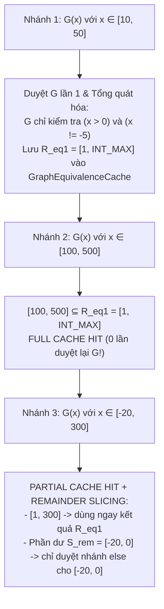

# Giới thiệu Công cụ `sqc` — Static Quality & Hazard Analyzer

**`sqc`** là công cụ phân tích tĩnh (Static Analysis & Formal Verification) thế hệ mới được viết bằng **C++20 trên nền LLVM 18 + Z3**, thiết kế chuyên biệt cho **C, Embedded C và hệ thống RTOS** (như driver cellular, UART/DMA, ngăn xếp giao thức mạng, firmware công nghiệp).

Mục tiêu cốt lõi của `sqc` là tìm ra các lỗi **Undefined Behavior (UB)** nguy hiểm (Null Pointer Dereference, Out-of-Bounds, Division by Zero, Signed Integer Overflow, Invalid Shift, Use-After-Free, Uninitialized Read...) kèm **Concrete Witness** (giá trị đầu vào cụ thể tái hiện lỗi) và **đo độ phủ mã nguồn chính xác tới từng điều kiện con (`&&`, `||`)**, mà **không bị bùng nổ trạng thái (State Explosion)**.

---

## 1. Ba Trụ Cột Thuật Toán Cốt Lõi

Thay vì duyệt vét cạn từng giá trị trong miền đầu vào hoặc phân tích lặp đi lặp lại các nhánh tương tự nhau, `sqc` kết hợp 3 trụ cột thuật toán:

### Trụ cột 1: Hazard-Guided Symbolic Partitioning (`Split-and-Filter` + `Z3Refiner`)

Mỗi biến hoặc vùng nhớ được biểu diễn bởi một **Symbolic Abstract Value**:
- **`Nullability`**: `MustNull`, `MustNonNull`, hoặc `MayNull`.
- **`TargetRegions`**: Tập các vùng nhớ hợp lệ `(RegionId, OffsetInterval)` mà con trỏ có thể trỏ tới.
- **`DisjointIntervals`**: Hợp của tối đa $K = 8$ khoảng đóng rời nhau $\bigcup [l_i, u_i]$ (ví dụ `[-100, -1] ∪ [1, 100]` khi đã loại bỏ điểm `0`).
- **`LinearSymExpr`**: Biểu thức tuyến tính dạng $c \cdot \alpha + b$ gắn với tham số đầu vào gốc $\alpha$ (ví dụ $y = (*a) + 10$).

Tại mọi lệnh IR có nguy cơ gây lỗi (**Hazard Sink**), engine sinh điều kiện lỗi $\Phi_{\text{err}}$ và áp dụng quy tắc **Split-and-Filter**:
1. **Kiểm tra khả năng gây lỗi ($S \cap \Phi_{\text{err}} \neq \emptyset$):**
   - Ví dụ tại `100 / (y - 25)` với $y = (*a) + 10$: điều kiện lỗi là $y - 25 = 0 \Leftrightarrow y = 25$.
   - `LinearSymExpr::solve_for_root(25)` truy ngược trực tiếp ra nguyên nhân gốc `*a == 15`.
   - Với các biểu thức ràng buộc nhiều biến phức tạp, **`Z3Refiner`** (SMT solver on-demand) kiểm tra tính khả thi `PathConstraints ∧ Φ_err` để loại bỏ dương tính giả (UNSAT) và sinh **Concrete Witness** chính xác.
2. **Thu hẹp trạng thái sống sót ($S_{\text{safe}} = S \cap \neg\Phi_{\text{err}}$):**
   - Loại bỏ chính xác điểm/miền lỗi bằng phép trừ khoảng `DisjointIntervals::subtract(...)` rồi tiếp tục phân tích phần còn lại trong **1 lượt duyệt duy nhất**.

| Loại lệnh IR | Điều kiện lỗi $\Phi_{\text{err}}$ | Trạng thái sống sót $\neg\Phi_{\text{err}}$ |
|---|---|---|
| Dereference `*p`, `p[i]` | `p == NULL` hoặc `offset < 0` hoặc `offset + width > size` | `p != NULL` và `0 <= offset <= size - width` |
| Chia / Chia dư `a / b`, `a % b` | `b == 0` hoặc `(a == INT_MIN && b == -1)` | `b ∈ [-∞, -1] ∪ [1, +∞]` |
| Cộng có dấu `a + b` | `a + b > INT_MAX` hoặc `a + b < INT_MIN` | `a + b ∈ [INT_MIN, INT_MAX]` |
| Dịch bit `a << b`, `a >> b` | `b < 0` hoặc `b >= bitwidth` | `b ∈ [0, bitwidth - 1]` |
| Đọc biến `v` | `!initialized(v)` | `initialized(v) == true` |
| Giải phóng `free(p)` | `liveness(p) == Freed` hoặc không phải heap / `offset != 0` | `liveness(p) = Freed` |

---

### Trụ cột 2: Graph Behavioral Equivalence & Remainder Slicing (`GraphEquivalenceCache`)

Khi một đồ thị hàm hoặc subgraph CFG $G(x)$ được gọi từ nhiều nhánh khác nhau với các dải đầu vào khác nhau (ví dụ Nhánh 1 truyền $x \in [10, 50]$, Nhánh 2 truyền $x \in [100, 500]$, Nhánh 3 truyền $x \in [-20, 300]$):

- Các bộ phân tích truyền thống chỉ cache theo chính xác input `[10, 50]` nên khi gặp `[100, 500]` (rời nhau hoàn toàn với `[10, 50]`) vẫn phải duyệt lại đồ thị $G$ một cách lãng phí.
- **`sqc` tổng quát hóa Miền Tương Đương Hành Vi Tối Đại ($\mathcal{R}_{eq}$):**
  1. Trong lần duyệt đầu tiên với $x \in [10, 50]$, `sqc` ghi nhận toàn bộ điều kiện rẽ nhánh và điều kiện an toàn mà $G$ thực sự kiểm tra (ví dụ `x > 0` và `x != -5`), từ đó suy ra **Miền Tương Đương Tối Đại** $\mathcal{R}_{eq}^{(1)} = [1, \text{INT\_MAX}]$ và lưu vào `GraphEquivalenceCache[G]`.
  2. Khi Nhánh 2 đi vào với $x \in [100, 500]$: vì $[100, 500] \subseteq \mathcal{R}_{eq}^{(1)} = [1, \text{INT\_MAX}]$, engine đạt **Full Cache Hit 100%** — áp dụng ngay kết quả và bitmap coverage mà **không duyệt lại đồ thị**.
  3. Khi Nhánh 3 đi vào với $x \in [-20, 300]$: engine thực hiện **Remainder Slicing**:
     $$S_{\text{rem}} = [-20, 300] \setminus [1, \text{INT\_MAX}] = [-20, 0]$$
     Phần $[1, 300]$ lấy trực tiếp từ cache, chỉ đẩy duy nhất phần dư $[-20, 0]$ vào duyệt nhánh `else` của đồ thị $G$.



---

### Trụ cột 3: Compositional ModRef Projection & Built-in Libc Summaries

1. **Liveness & ModRef Projection (`LivenessAndModRefPass`):**
   - Trước khi phân tích, `sqc` tính tập biến sống `LiveIn(BB)` cho từng BasicBlock và tập biến đọc/ghi `ReadSet(fn)` / `WriteSet(fn)` cho từng hàm.
   - Khi hàm `A` gọi hàm `B`, trạng thái đầu vào được chiếu xuống đúng các biến trong `ReadSet(B)`. Mọi thay đổi ở hàm `A` trên các biến mà `B` không đọc tới đều bị bỏ qua khi tra cứu `GraphEquivalenceCache` $\rightarrow$ hàm `B` chỉ cần phân tích đúng 1 lần.
2. **Built-in $O(1)$ Semantic Summaries cho Libc (`BuiltinSummaryRegistry`):**
   - Thay vì yêu cầu người dùng viết hàng trăm dòng stub thủ công (như 554 dòng `sscanf` trong các bộ công cụ cũ), `sqc` tích hợp sẵn mô hình ngữ nghĩa $O(1)$ cho các hàm chuẩn C ngay trên LLVM IR:
     - Chuỗi & định dạng: `sscanf`, `snprintf`, `sprintf`, `strlen`, `strcpy`, `strncpy`, `strcmp`, `strncmp`, `strtol`, `strtoul`
     - Bộ nhớ & cấp phát: `memcpy`, `memmove`, `memset`, `malloc`, `calloc`, `free`
   - Tự động kiểm tra tính hợp lệ của vùng đệm, ranh giới bộ nhớ và byte kết thúc chuỗi `'\0'` (`null_term_offset`) trong vài micro-giây.

---

## 2. Cơ Chế Đo Độ Phủ Mã Nguồn (LoC & Sub-Condition Coverage)

### 2.1. Độ phủ Line-of-Code (LoC) theo File và theo Từng Hàm

- **Mẫu số chính xác (Executable Lines):** Ngay ở tầng LLVM DWARF (`-g -gcolumn-info`), `CoverageTracker` chỉ đếm các dòng chứa lệnh thực thi thực sự trong từng hàm $f$ thuộc file $F$, loại bỏ dòng trống, comment, khai báo `struct`/`typedef`, và dấu ngoặc đơn lẻ.
- **Tích hợp liền mạch với `GraphEquivalenceCache`:** Mỗi `BehavioralEquivalenceRegion` ($\mathcal{R}_{eq}$) lưu kèm tập dòng code đã đi qua (`covered_file_lines`) và mặt nạ điều kiện con (`subcondition_truth_masks`). Khi xảy ra **Cache Hit**, engine chỉ cần gộp (OR) tập dòng đã phủ trong $O(1)$ — vừa giữ tốc độ cao vừa đảm bảo độ phủ 100% trung thực với tập input của `sqc_main`.
- **Công thức tính:**
  $$\text{FuncCov}(F, f) = \frac{|C(F, f)|}{|E(F, f)|} \times 100\%, \qquad \text{FileCov}(F) = \frac{\left|\bigcup_f C(F, f)\right|}{\left|\bigcup_f E(F, f)\right|} \times 100\%$$

### 2.2. Độ phủ Điều kiện Con (Sub-Condition Coverage cho `||`, `&&` trên `if`, `while`, `for`)

Điểm nổi bật của `sqc` là phân biệt rõ ràng giữa **độ phủ của từng điều kiện con (Atomic Sub-Condition)** trên dòng điều khiển với **độ phủ của khối lệnh bên trong thân nhánh**:

- Clang/LLVM tách các biểu thức ngắn mạch (`||`, `&&`) thành các lệnh rẽ nhánh nguyên tử mang tọa độ DWARF tới từng cột `(File, Line, Col)`.
- Với mỗi điều kiện con $c_i$, `sqc` theo dõi mặt nạ 2-bit **`TruthMask`**:
  - `0b00`: Chưa bao giờ được đánh giá (bị short-circuit hoàn toàn).
  - `0b01`: Chỉ mới xảy ra `True` (chưa bao giờ `False`).
  - `0b10`: Chỉ mới xảy ra `False` (không bao giờ xảy ra `True`).
  - `0b11`: Đã phủ đủ cả hai chiều `True` và `False`.
- **Quy tắc tách biệt dòng điều kiện và thân nhánh:**
  - Nếu dòng `if (status == 1 || status == 99)` có `status ∈ [0, 5]`, thì `status == 99` **không bao giờ `True`** $\rightarrow$ dòng `if (...)` được tô **Vàng (`COVERED_PARTIAL`)** kèm chú thích chi tiết, trong khi **các dòng lệnh bên trong thân `if { ... }`** vẫn được phân tích đầy đủ và tô **Xanh lá (`COVERED_SAFE`)**.
  - Tương tự với vòng lặp `while (count < 4 && hw_ready)` khi `hw_ready` luôn là `1` (chưa bao giờ `False`) $\rightarrow$ dòng `while (...)` tô **Vàng**, còn thân vòng lặp vẫn tô **Xanh lá**.

```text
 27 | 🟨 if (status == 1 || status == 99) {     [Partial: `status == 99` Never True]
 29 | 🟩     acc += 100;                        [Covered & Proven Safe]
 30 | 🟩     acc += status;                     [Covered & Proven Safe]
 31 | 🟩 }
 37 | 🟨 while (count < 4 && hw_ready) {        [Partial: `hw_ready` Never False]
 39 | 🟩     acc += count;                      [Covered & Proven Safe]
 40 | 🟩     count++;                           [Covered & Proven Safe]
 41 | 🟩 }
```

### 2.3. Bảng Ý Nghĩa 6 Màu Sắc trên Báo Cáo HTML (`Source Viewer`)

| Trạng thái (`LineStatus`) | Màu sắc | Ý nghĩa kỹ thuật |
|---|---|---|
| **`COVERED_SAFE`** | 🟩 **Xanh lá** | Dòng lệnh đã được phân tích đi qua và chứng minh an toàn; nếu là dòng điều kiện (`if`/`while`/`for`) thì mọi điều kiện con (`&&`, `||`) đều đã phủ đủ cả `True` và `False`. |
| **`COVERED_PARTIAL`** | 🟨 **Vàng** | Dòng điều kiện (`if`, `else if`, `while`, `for`, `?:`) có ít nhất một điều kiện con chưa phủ đủ cả hai chiều `True`/`False` (thân nhánh bên trong nếu đi vào được vẫn tô 🟩 Xanh lá). |
| **`COVERED_ALARM`** | 🟧 **Cam / Đỏ đậm** | Dòng lệnh đã đi qua và phát hiện **Hazard / Undefined Behavior** — hiển thị chi tiết điều kiện lỗi $\Phi_{\text{err}}$, Callstack và Concrete Witness. |
| **`DEAD_AFTER_FATAL_UB`** | 🟪 **Tím** | Dòng lệnh không thể đạt tới vì lệnh ngay phía trên chắc chắn 100% gây lỗi nghiêm trọng (`Must-Fail UB`). |
| **`UNCOVERED`** | 🟥 **Đỏ nhạt** | Dòng lệnh thực thi nhưng chưa bao giờ được đi qua (0 lần thực thi) với tập đầu vào của `sqc_main`. |
| **`NON_EXECUTABLE`** | ⬜ **Trắng / Mặc định** | Comment, dòng trống, khai báo kiểu/macro (không tính vào mẫu số LoC Coverage). |

---

Tiếp theo, xem hướng dẫn cài đặt, cấu hình và thực hành chi tiết trong [GETTING_STARTED.md](GETTING_STARTED.md).
